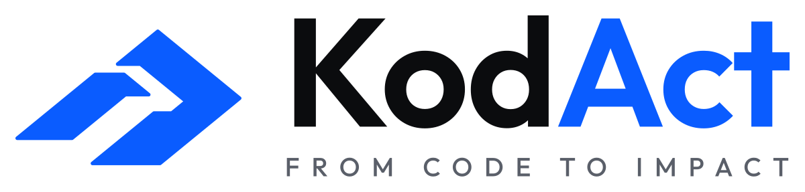

# KodAct logo

The mark is two strokes on one slope: a step up from the left, then a chevron
pointing right. Code goes in, impact comes out. The name says the rest:
KodAct, *from code to impact*.



## Files

| File | Use |
| --- | --- |
| `kodact-logo.svg` | The logo with its tagline, on light backgrounds |
| `kodact-logo-on-dark.svg` | The logo with its tagline, on dark backgrounds |
| `kodact-logo-stacked.svg`, `kodact-logo-stacked-on-dark.svg` | The logo stacked, for square spaces |
| `kodact-mark.svg`, `kodact-mark-on-dark.svg` | The mark alone, in Signal blue |
| `kodact-mark-ink.svg`, `kodact-mark-paper.svg` | The mark in one colour: ink, or paper on dark |
| `kodact-wordmark.svg`, `kodact-wordmark-on-dark.svg` | The name alone |
| `app-icon.svg` | App icon: the paper mark on a Signal-blue tile |
| `app-icon-dark.svg` | App icon: the blue mark on an ink tile |
| `kodact.ico` | Windows icon, 16 to 256 px; the copy in `crates/kodact-cli/assets/` is built into kodact.exe |
| `favicon.ico` | Browser icon, 16, 32 and 48 px |
| `png/` | The files above as PNG, with transparent backgrounds |

## Colours

| Colour | Hex | Where |
| --- | --- | --- |
| Signal blue | `#0a5cff` | The mark and "Act" on light backgrounds; the app icon's tile |
| Signal blue, lifted | `#4d8dff` | The mark and "Act" on dark backgrounds, where `#0a5cff` falls under 4.5:1 |
| Ink | `#0b0c0e` | "Kod" on light backgrounds; the dark tile |
| Paper | `#ffffff` | "Kod" on dark backgrounds; the mark on the blue tile |
| Slate | `#5a5f69` | The tagline on light backgrounds |
| Mist | `#9a9fa8` | The tagline on dark backgrounds |

The terminal keeps KodAct's own palette (`crates/kodact-cli/src/tui/palette.rs`):
ink, paper and lime (`#c6ff3d`, olive `#4a7200` on light backgrounds), with
teal and violet beside it. It draws the same mark and letters in lime.

## Type

| Use | Font |
| --- | --- |
| The name, "KodAct" | Outfit SemiBold (620), tracked −1.5% |
| The tagline, FROM CODE TO IMPACT | Outfit Medium, capitals tracked wide, set to the name's width |
| Code, and the terminal | JetBrains Mono |

Outfit's geometric letters (the round o and d, the pointed A, the t's curled
foot) match the mark's clean slopes; JetBrains Mono is the face KodAct is
read in. Both fonts are under the SIL Open Font License 1.1. The SVG files
hold the letters as outlines, so nothing needs a font installed. The
terminal's pixel wordmark follows the same letters.

## Using it

- Leave clear space around the logo of at least the height of "Kod"'s `o`.
- Below 160 px wide, use the logo without its tagline (the wordmark), or the
  mark alone. Below 48 px, use the app icon.
- Use the plain files on light backgrounds and the `-on-dark` files on dark
  ones.
- Don't recolour the mark, change its slope, stretch it, or add shadows or
  glows.

## Editing

The SVG files are the masters. `source/build_svgs.py` writes them all from one
drawing, then the PNG and ICO files:

```bash
pip install fonttools uharfbuzz cairosvg pillow
# Outfit[wght].ttf from github.com/google/fonts (ofl/outfit), saved as outfit.ttf
python3 source/build_svgs.py design/brand <font folder>
cp design/brand/kodact.ico crates/kodact-cli/assets/kodact.ico
```
