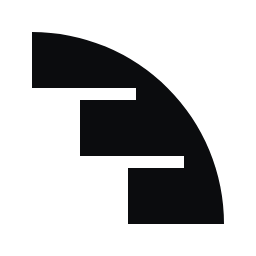
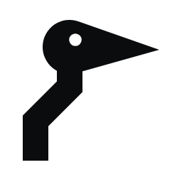
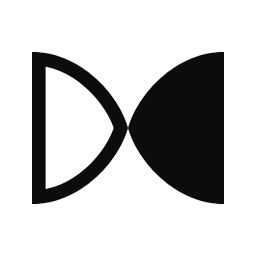

# KodAct identity exploration, November 2026

A new symbol for KodAct, worked out from the brief "code becomes action":
ten different concepts in black on white, three developed, one recommended.
This is an exploration. The logo in `design/brand/` is unchanged until a
direction is chosen.

Open `presentation.html` in a browser to see everything together: the ten
concepts with the reason each was kept or dropped, and for each finalist the
256 px symbol in black and in white, true-size 24 and 16 px renders with a
magnified pixel test, horizontal lockups, and a signature colour.

## Finalists

| | Symbol | Idea | Colour |
| --- | --- | --- | --- |
| **Recommended** |  | **Indent.** Three lines of code, each indented one step deeper, fuse into one quarter-turn sweep. | Cobalt `#1f3fd1` |
| Second |  | **Heron.** Stands still, reads the water, strikes once. The kink in its neck is the strike held in reserve. | Night indigo `#2a2670` |
| Third |  | **Half-turn.** One ribbon, one half-turn: the outlined face (the plan) turns into the solid face (the act). | Kiln `#b23c17` |

Indent is recommended because it is the only finalist that stays unambiguous at
16 px, no part of it reads as a letter, and its silhouette (stepped inside,
swept outside) has no near neighbour among developer tools.

## Files

| Path | What |
| --- | --- |
| `concepts/` | The ten concepts, black on white |
| `finalists/<name>/symbol-black.svg`, `-white.svg`, `-colour.svg` | Master symbol, 64-unit grid |
| `finalists/<name>/symbol-24.svg`, `symbol-16.svg` (and `-white`) | Separate drawings fitted to the 24 and 16 px grids |
| `finalists/<name>/lockup-*.svg` | Symbol and wordmark, horizontal: black, white, colour, colour on dark |
| `png/` | Renders of the finalists at 16, 24 and 256 px, and the lockups |
| `source/` | `symbols.py` (drawings), `build.py` (files and page), `render.js` (PNGs) |

The wordmark is Instrument Sans SemiBold (SIL Open Font License 1.1) with
tracking tightened by 1.2%, stored as outlines, so no font needs installing.

## Rebuilding

```bash
pip install fonttools uharfbuzz
# InstrumentSans-SemiBold.ttf from Google Fonts
cd source
python3 build.py <path>/InstrumentSans-SemiBold.ttf ..
node render.js ..      # needs Playwright with Chromium
```

## Next, once a direction is chosen

1. Refine it: optical corrections, a reversed cut with slightly thinner gaps,
   construction drawings.
2. Build the kit: Windows `.ico` (16 to 256 px), favicon, CLI banner, lockups,
   a usage page; then replace the files in `design/brand/`.
